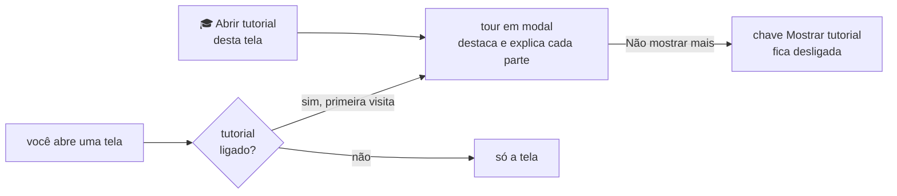
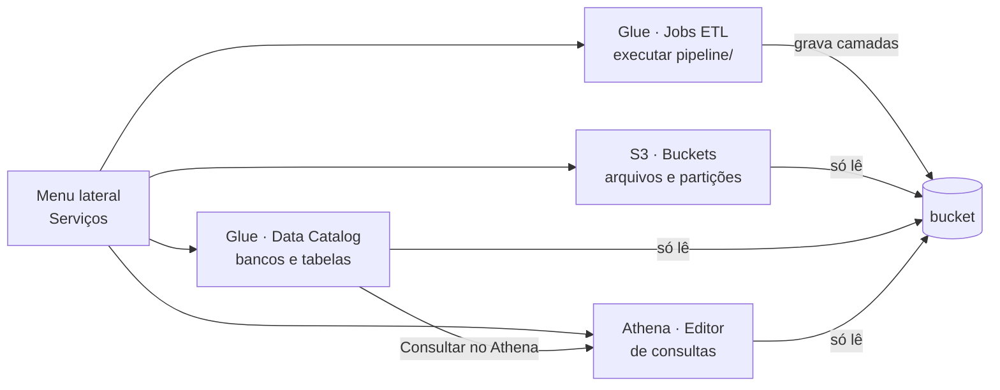
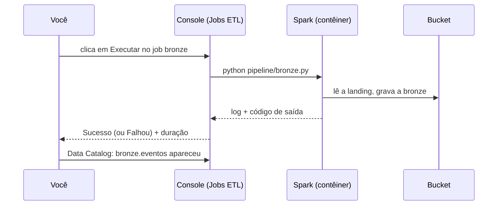
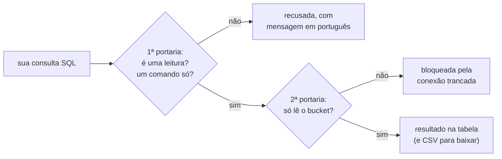

# Explorador do datalake (console de estudo)

Um site que roda no seu computador para **olhar o bucket** sem escrever código: ver os arquivos que o gerador e o seu pipeline gravaram, ver o catálogo de tabelas, **rodar os seus jobs** e fazer **consultas SQL** sobre os dados.

> **Pense assim:** o explorador é uma **vitrine de vidro** na frente do bucket, com uma bancada de trabalho ao lado. Pela vitrine (S3, Data Catalog e Athena) você vê tudo e faz perguntas, mas não mexe em nada. Na bancada (Jobs ETL) você manda rodar os jobs que você mesmo escreveu.

## Como abrir

Antes, construa a imagem uma vez (é o Passo 2 do [SETUP.md](../SETUP.md)): `docker compose build app`. O explorador usa essa mesma imagem; sem ela, ele não sobe.

```bash
docker compose up -d floci explorador
```

Abra **http://localhost:8501** no navegador. Para desligar: `docker compose stop explorador`.

## Tutorial em cada tela

Na primeira vez que você abre cada tela, aparece um **tour em modal**: a tela escurece, um contorno laranja destaca um elemento (o menu, a lista de buckets, o editor de SQL…) e um balão explica para que ele serve. Use **Próximo** e **Anterior** para andar pelos passos e **✕** (ou a tecla Esc) para fechar.

> **Pense assim:** é o **guia de um museu** que para em frente a cada peça e conta para que ela serve. Na primeira visita ele te acompanha; depois você anda sozinho e chama o guia só quando quiser.

- **Rever o tour:** no menu lateral, clique em **🎓 Abrir tutorial desta tela**. Funciona mesmo com o tutorial desligado.
- **Desligar:** marque **Não mostrar mais o tutorial** no balão, ou desligue a chave **Mostrar tutorial** no menu lateral. A escolha fica gravada em `.explorador/preferencias.json` (fora do git) e vale também depois de reiniciar o explorador. Para religar, ligue a chave de novo.



## As quatro telas: S3, Glue e Athena

O explorador imita o jeito de trabalhar do console da AWS, para você treinar o fluxo que vai usar no mercado. O menu lateral (**Serviços**) tem quatro telas:

> **Pense assim:** é um **simulador de cabine**. Os botões estão no mesmo lugar dos do avião de verdade (o console da AWS), mas tudo roda no seu computador: o floci no lugar do S3, o DuckDB no lugar do Athena e o Spark do contêiner no lugar do Glue. Nada aqui usa nem cobra serviços da AWS.



### S3 · Buckets

- **Lista de buckets:** a tabela mostra o bucket `datalake-tracking`, a região, quantos objetos ele tem e o tamanho total. Clique no nome para entrar.
- **Caminho no topo (breadcrumb):** `Buckets › datalake-tracking › silver › event_name=purchase`. Clique em qualquer parte para voltar até ela.
- **Aba Objetos:** as pastas (📁) e os arquivos (📄) da pasta atual, com tipo, última modificação e tamanho. Clique numa pasta para entrar; clique num `.parquet` ou `.jsonl` para ver as primeiras 100 linhas logo abaixo.
- **Aba Partições:** escolha um dataset e veja uma linha por partição (`event_name`, `year`, `month`, `day`) com quantos arquivos e quantos bytes ela tem. Quando o dataset não tem uma dessas partições, a coluna mostra `—`. O botão "Contar linhas por partição" conta as linhas de cada uma.
- **Aba Propriedades:** nome, região, endpoint, total de objetos e tamanho do bucket.

### Glue · Data Catalog

O **Data Catalog** é a lista de "o que existe no lake": quais bancos, quais tabelas, onde ficam os arquivos e quais colunas cada uma tem.

> **Pense assim:** é o **catálogo de uma biblioteca**. Os livros (os arquivos) estão nas estantes (o bucket); o catálogo diz em que estante está cada livro, de que assunto ele é e como ele é organizado, sem você precisar andar pelos corredores.

- **Bancos de dados:** um por camada do medalhão: `landing`, `bronze`, `silver` e `gold`, cada um com a sua localização `s3://datalake-tracking/<banco>/`.
- **Tabelas do banco:** nome, formato (Parquet ou JSON), localização, quantas partições e quantas colunas.
- **Detalhe da tabela:**
  - **Esquema:** as colunas e os tipos; as chaves de partição aparecem marcadas;
  - **Partições:** uma linha por partição, com arquivos e tamanho;
  - **Propriedades:** banco, localização, classificação e o nome para usar no Athena.
- O botão **Consultar no Athena** abre uma aba nova no editor já com `SELECT * FROM <banco>.<tabela> LIMIT 10`.

### Glue · Jobs ETL

Aqui ficam os **seus jobs**: os arquivos `.py` da pasta `pipeline/` (menos o `comum.py`, que é peça de apoio).

> **Pense assim:** é o **painel do forno**. Cada job é uma receita; você aperta **Executar**, acompanha pela janelinha (o log) e, no fim, o painel diz se deu certo (**Sucesso**) ou não (**Falhou**) e quanto tempo levou.

- **Lista de jobs:** nome, script, status da última execução e a hora em que ela começou.
- **Detalhe do job:**
  - **Executar:** roda `python pipeline/<job>.py` no contêiner do explorador, que já tem o Spark. É o mesmo que rodar `docker compose run --rm app python pipeline/<job>.py` no terminal. Enquanto o job roda, o botão fica desligado: um job por vez.
  - **Execuções:** status (**Em execução**, **Sucesso** ou **Falhou**), início, duração e código de saída de cada execução, com o **log** logo abaixo. Enquanto um job roda, o painel se atualiza sozinho a cada 3 segundos.
  - **Script:** o código do job, só para leitura (você edita no seu editor, como sempre).
- O histórico de execuções fica dentro do contêiner do explorador: se ele reiniciar, o histórico zera (os dados gravados no bucket continuam lá).
- Esta é a única tela que **grava** no bucket, e só através do código dos seus jobs. As outras três só leem.



### Athena · Editor de consultas

- **À esquerda, a árvore de dados:** escolha o **banco de dados** (`landing`, `bronze`, `silver`, `gold`) e veja as **tabelas** dele. Abra uma tabela para ver as colunas e os tipos; o botão **Inserir no editor** escreve `<banco>.<tabela>` no fim da sua consulta. Ali também ficam as **consultas de exemplo**.
- **Abas de consulta:** "Consulta 1", "Consulta 2"… Cada aba guarda a própria SQL e o próprio resultado. O **＋** abre uma aba nova; o **✕** fecha a aba atual (a última nunca fecha).
- **Editor:** escreva a SQL e clique em **Executar**. O campo **Limite de linhas** diz quantas linhas trazer: o padrão é 1 000 e o máximo é 50 000. Se a consulta tiver mais linhas que o limite, o resultado é cortado e aparece um aviso.
- **Resultados:** a faixa verde mostra os **detalhes da execução**, como o Athena: status, tempo de execução, número de linhas e **dados lidos (estimado)**. Embaixo, a tabela e o botão **Baixar resultados (CSV)**.
  - O Athena cobra pelos dados que lê, por isso mostra esse número. Aqui ele é uma **estimativa**: a soma do tamanho dos arquivos das tabelas que a sua SQL usa. Se a SQL filtra a partição com valores fixos (`WHERE event_name = 'purchase'` ou `event_name IN (...)`), só entram os arquivos dessas partições, como o Athena faz ao pular pastas inteiras ("partition pruning"). Compare `SELECT count(*) FROM landing.eventos` com a mesma consulta filtrando `event_name`: o número cai, e no Athena de verdade a conta também.
- **Erros:** a faixa vermelha explica em português o que costuma causar o erro (nome de tabela ou coluna errado, erro de escrita…) e mostra embaixo a mensagem original do DuckDB, que vem em inglês.
- **Consultas recentes:** a lista das consultas desta sessão, com hora, status, tempo, linhas e dados lidos. Clique numa delas para abri-la de novo no editor. O histórico vale enquanto a aba do navegador estiver aberta; recarregar a página zera.

## Bancos e tabelas: os nomes que você usa no SQL

Cada pasta com dados vira uma **tabela** do catálogo, no formato `<banco>.<tabela>`. O banco é a camada (a primeira pasta); a tabela é o resto do caminho, antes das partições `k=v`. As partições `event_name=` que ficam direto na raiz da camada formam a tabela `eventos`.

> **Pense assim:** a tabela é um **atalho na área de trabalho**. Ela não guarda uma cópia dos dados; quando você abre (`SELECT … FROM silver.eventos`), ela vai até a pasta e lê os arquivos naquela hora. Por isso, depois de rodar um job, a consulta já mostra os dados novos (clique em **Recarregar** se for uma pasta nova).

| Pasta no bucket | Tabela |
| --- | --- |
| `landing/event_name=…/` | `landing.eventos` |
| `bronze/event_name=…/` | `bronze.eventos` |
| `silver/event_name=…/` | `silver.eventos` |
| `silver/itens/` | `silver.itens` |
| `silver/eventos_rejeitados/` | `silver.eventos_rejeitados` |
| `gold/funil_compra/` | `gold.funil_compra` |

A tabela `silver.eventos` lê só as pastas `event_name=…`: as vizinhas `silver/itens/` e `silver/eventos_rejeitados/` são tabelas próprias.

Se uma pasta tiver arquivos `.parquet` e `.jsonl` misturados, ela vira duas tabelas, com o formato no fim do nome (ex.: `landing.mista_jsonl` e `landing.mista_parquet`).

As tabelas das pastas particionadas têm as colunas de partição (`event_name`, `year`, `month`, `day`), como texto (`month` é `'09'`).

Exemplos:

```sql
SELECT event_name, count(*) AS eventos FROM landing.eventos GROUP BY event_name ORDER BY eventos DESC;
SELECT year, month, day, count(*) AS linhas FROM silver.eventos WHERE event_name = 'purchase' GROUP BY ALL ORDER BY ALL;
SELECT * FROM gold.funil_compra;
DESCRIBE silver.eventos;
```

## Somente leitura (S3, Data Catalog e Athena)

Três das quatro telas só **leem**. As consultas do Athena têm duas proteções:

1. Aceita consultas que começam com `SELECT`, `WITH`, `DESCRIBE`, `SHOW`, `SUMMARIZE`, `FROM`, `EXPLAIN` ou `PRAGMA table_info`, uma por vez. Comandos que mudam dados (`COPY`, `CREATE`, `DROP`, `INSERT`…) são recusados. `EXPLAIN ANALYZE` também é recusado, porque ele executa o comando de verdade; use só `EXPLAIN`.
2. A conexão com o DuckDB é **trancada** no bucket: ela não lê arquivos do computador nem muda configurações.

> **Pense assim:** é um prédio com **duas portarias**. A primeira (a validação) confere se o seu pedido é só de leitura; a segunda (a trava da conexão) garante que, mesmo que algo escape da primeira, ninguém sai do andar do bucket.



A tela **Jobs ETL** é a exceção: ela roda os scripts da pasta `pipeline/`, e quem grava é o código desses scripts, exatamente como no terminal. O console nunca roda um comando digitado: só os arquivos que aparecem na lista.

Se algo inesperado acontecer, o site mostra uma mensagem amigável e, embaixo dela, uma linha curta de "Detalhe técnico" para ajudar a achar a causa.

As consultas usam o **DuckDB**, um motor SQL rápido para arquivos. Ele serve só para explorar. O seu pipeline continua sendo construído com o Spark, como pede o enunciado.

Depois de rodar um job novo, clique em **Recarregar** para o explorador encontrar as pastas novas e as colunas novas das tabelas. (Sem clicar, a lista de arquivos se atualiza sozinha a cada 30 segundos, mas a lista de colunas não.)
