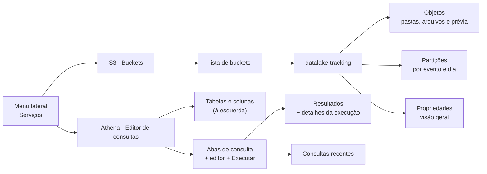
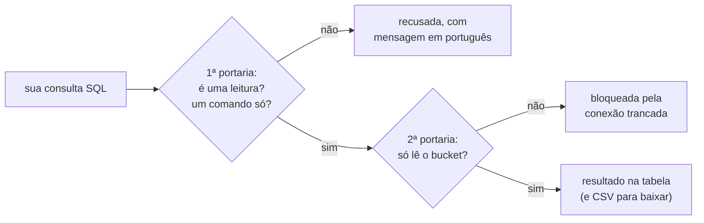

# Explorador do datalake (console de estudo)

Um site que roda no seu computador para **olhar o bucket** sem escrever código: ver os arquivos que o gerador e o seu pipeline gravaram, ver as partições (`event_name=`, `year=`, `month=`, `day=`) de cada pasta e fazer **consultas SQL** sobre os dados.

> **Pense assim:** o explorador é uma **vitrine de vidro** na frente do bucket. Você vê tudo o que está lá dentro, pode apontar e fazer perguntas ("quantas compras houve no dia 3?"), mas não consegue mexer em nada: o vidro protege o seu datalake.

## Como abrir

Antes, construa a imagem uma vez (é o Passo 2 do [SETUP.md](../SETUP.md)): `docker compose build app`. O explorador usa essa mesma imagem; sem ela, ele não sobe.

```bash
docker compose up -d floci explorador
```

Abra **http://localhost:8501** no navegador. Para desligar: `docker compose stop explorador`.

## As duas telas: S3 e Athena

O explorador imita o jeito de trabalhar do console da AWS, para você treinar o fluxo que vai usar no mercado. O menu lateral (**Serviços**) tem duas telas:

> **Pense assim:** é um **simulador de cabine**. Os botões estão no mesmo lugar dos do avião de verdade (o console da AWS), mas tudo roda no seu computador, com o floci no lugar do S3 e o DuckDB no lugar do Athena. Nada aqui usa nem cobra serviços da AWS.



### S3 · Buckets

- **Lista de buckets:** a tabela mostra o bucket `datalake-tracking`, a região, quantos objetos ele tem e o tamanho total. Clique no nome para entrar.
- **Caminho no topo (breadcrumb):** `Buckets › datalake-tracking › silver › event_name=purchase`. Clique em qualquer parte para voltar até ela.
- **Aba Objetos:** as pastas (📁) e os arquivos (📄) da pasta atual, com tipo, última modificação e tamanho. Clique numa pasta para entrar; clique num `.parquet` ou `.jsonl` para ver as primeiras 100 linhas logo abaixo.
- **Aba Partições:** escolha um dataset e veja uma linha por partição (`event_name`, `year`, `month`, `day`) com quantos arquivos e quantos bytes ela tem. Quando o dataset não tem uma dessas partições, a coluna mostra `—`. O botão "Contar linhas por partição" conta as linhas de cada uma.
- **Aba Propriedades:** nome, região, endpoint, total de objetos e tamanho do bucket.

### Athena · Editor de consultas

- **À esquerda, a árvore de dados:** a fonte (floci), o banco `datalake` e as **tabelas** (as views). Abra uma tabela para ver as colunas e os tipos; o botão **Inserir no editor** escreve o nome da tabela no fim da sua consulta. Ali também ficam as **consultas de exemplo**.
- **Abas de consulta:** "Consulta 1", "Consulta 2"… Cada aba guarda a própria SQL e o próprio resultado. O **＋** abre uma aba nova; o **✕** fecha a aba atual (a última nunca fecha).
- **Editor:** escreva a SQL e clique em **Executar**. O campo **Limite de linhas** diz quantas linhas trazer: o padrão é 1 000 e o máximo é 50 000. Se a consulta tiver mais linhas que o limite, o resultado é cortado e aparece um aviso.
- **Resultados:** a faixa verde mostra os **detalhes da execução**, como o Athena: status, tempo de execução, número de linhas e **dados lidos (estimado)**. Embaixo, a tabela e o botão **Baixar resultados (CSV)**.
  - O Athena cobra pelos dados que lê, por isso mostra esse número. Aqui ele é uma **estimativa**: a soma do tamanho dos arquivos das tabelas que a sua SQL usa. Se a SQL filtra a partição com valores fixos (`WHERE event_name = 'purchase'` ou `event_name IN (...)`), só entram os arquivos dessas partições, como o Athena faz ao pular pastas inteiras ("partition pruning"). Compare `SELECT count(*) FROM landing` com a mesma consulta filtrando `event_name`: o número cai, e no Athena de verdade a conta também.
- **Erros:** a faixa vermelha explica em português o que costuma causar o erro (nome de tabela ou coluna errado, erro de escrita…) e mostra embaixo a mensagem original do DuckDB, que vem em inglês.
- **Consultas recentes:** a lista das consultas desta sessão, com hora, status, tempo, linhas e dados lidos. Clique numa delas para abri-la de novo no editor. O histórico vale enquanto a aba do navegador estiver aberta; recarregar a página zera.

## Views: os nomes que você usa no SQL

Cada pasta com dados vira uma **view**, uma tabela virtual que lê os arquivos na hora. O nome é o caminho da pasta, antes das partições `k=v`, com `_` no lugar de `/`:

> **Pense assim:** a view é um **atalho na área de trabalho**. Ela não guarda uma cópia dos dados; quando você abre (`SELECT … FROM silver`), ela vai até a pasta e lê os arquivos naquela hora. Por isso, depois de rodar um job, a consulta já mostra os dados novos (clique em **Recarregar** se for uma pasta nova).

| Pasta no bucket | View |
| --- | --- |
| `landing/event_name=…/` | `landing` |
| `bronze/event_name=…/` | `bronze` |
| `silver/event_name=…/` | `silver` |
| `silver/itens/` | `silver_itens` |
| `gold/funil_compra/` | `gold_funil_compra` |

A view `silver` lê só as pastas `event_name=…`: as vizinhas `silver/itens/` e `silver/eventos_rejeitados/` têm views próprias.

Se uma pasta tiver arquivos `.parquet` e `.jsonl` misturados, ela vira duas views, com o formato no fim do nome (ex.: `landing_jsonl` e `landing_parquet`).

As views das pastas particionadas têm as colunas de partição (`event_name`, `year`, `month`, `day`), como texto (`month` é `'09'`). A lista completa de tabelas e colunas aparece na árvore à esquerda da tela **Athena · Editor de consultas**. No editor, as views aparecem como **tabelas** do banco `datalake`, como no Athena.

Exemplos:

```sql
SELECT event_name, count(*) AS eventos FROM landing GROUP BY event_name ORDER BY eventos DESC;
SELECT year, month, day, count(*) AS linhas FROM silver WHERE event_name = 'purchase' GROUP BY ALL ORDER BY ALL;
DESCRIBE silver;
```

## Somente leitura

O explorador só **lê**. Ele tem duas proteções:

1. Aceita consultas que começam com `SELECT`, `WITH`, `DESCRIBE`, `SHOW`, `SUMMARIZE`, `FROM`, `EXPLAIN` ou `PRAGMA table_info`, uma por vez. Comandos que mudam dados (`COPY`, `CREATE`, `DROP`, `INSERT`…) são recusados. `EXPLAIN ANALYZE` também é recusado, porque ele executa o comando de verdade; use só `EXPLAIN`.
2. A conexão com o DuckDB é **trancada** no bucket: ela não lê arquivos do computador nem muda configurações.

> **Pense assim:** é um prédio com **duas portarias**. A primeira (a validação) confere se o seu pedido é só de leitura; a segunda (a trava da conexão) garante que, mesmo que algo escape da primeira, ninguém sai do andar do bucket.



Assim, você não estraga o seu datalake por engano. Se algo inesperado acontecer, o site mostra uma mensagem amigável e, embaixo dela, uma linha curta de "Detalhe técnico" para ajudar a achar a causa.

As consultas usam o **DuckDB**, um motor SQL rápido para arquivos. Ele serve só para explorar. O seu pipeline continua sendo construído com o Spark, como pede o enunciado.

Depois de rodar um job novo, clique em **Recarregar** para o explorador encontrar as pastas novas e as colunas novas das views. (Sem clicar, a lista de arquivos se atualiza sozinha a cada 30 segundos, mas a lista de colunas não.)
